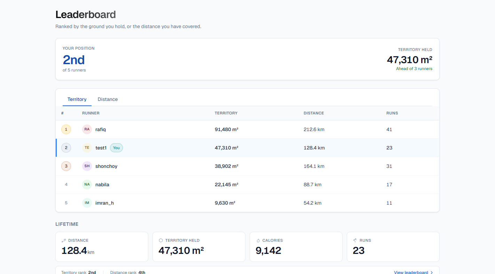
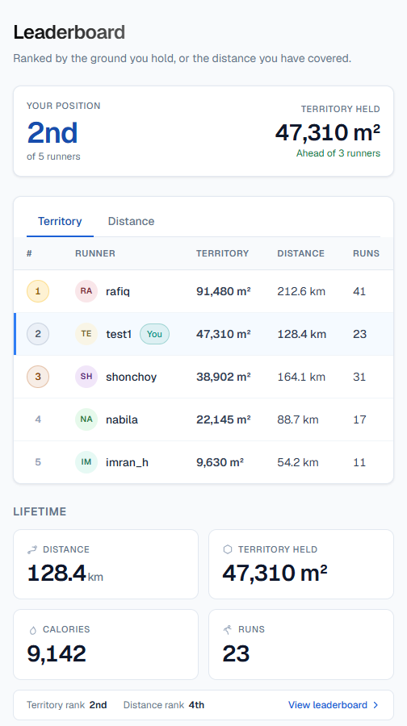

# Territory Runner

A running app where closing a GPS loop captures the ground inside it. Run over
someone else's territory and the overlap becomes yours — so the map is always
contested and there is always a reason to go out again.

- **GPS tracking** with accuracy filtering, pause support and live pace
- **Territory capture** on any closed loop, with area measured on the spheroid
- **Territory stealing** — a newer loop takes 100% of the overlap, resolved
  atomically in PostGIS
- **Streak calendar** where a longer run gives a deeper, bolder day
- **Monthly and yearly summaries** — distance, calories, area gained, area
  lost, most-visited places, streaks, leaderboard position
- **Leaderboards** by territory held and by distance covered
- **Email sign-in** via Supabase Auth. Google and Facebook sign-in are built
  but switched off (`ENABLE_GOOGLE_OAUTH`, `ENABLE_FACEBOOK_OAUTH`) until their
  OAuth clients exist
- **Android app** (Expo, in [`mobile/`](mobile/)) that keeps recording with
  the screen locked and queues points offline

## Screenshots

| Leaderboard | Leaderboard (mobile) |
| --- | --- |
|  |  |

## Stack

| Layer | Choice | Why |
| --- | --- | --- |
| Server | Node 20, Express, EJS | Server-rendered pages, small payloads |
| Database | **Supabase Postgres + PostGIS** | Territory stealing is a geometry-difference problem; the database should solve it |
| Auth | **Supabase Auth** | Native Google/Facebook providers, token refresh and account linking without writing any of it |
| Geo | PostGIS (`ST_Difference`, `ST_Union`, GiST) | Correct, indexed and transactional |
| Maps | Leaflet + MapTiler (web), MapLibre (mobile) | Sharper tiles, and within a provider's terms of use |
| Mobile | Expo SDK 51 development build | Background GPS, which a browser cannot do |
| Hosting | Render (free web service) | Free HTTPS, deploys on every push |
| Styling | Tailwind CSS with a build step | One token set, no runtime CSS compilation |
| Logging | pino | Non-blocking, unlike `console.log` in a hot path |

## Quick start

```bash
npm install
cp .env.example .env     # fill in the Supabase and MapTiler values
npm run init-db          # applies config/schema.sql + functions.sql
npm run dev              # Tailwind watcher + nodemon
```

Open <http://localhost:3000>.

In the Supabase dashboard, **Database → Extensions → enable `postgis`** before
running `init-db`. Supabase installs it in the `extensions` schema, which the
SQL functions already account for.

Location only works on `https://` or `http://localhost`. Opening the dev server
from a phone at `http://192.168.x.x:3000` loads the pages but the browser will
not share GPS; use the mobile app or the deployed HTTPS site instead.

`.env.example` documents exactly where each value comes from. Note that
`DATABASE_URL` must be the **pooled** connection string (port 6543) while
`DIRECT_URL` must be the **direct** one (port 5432) — migrations need a real
session for `CREATE EXTENSION`.

> If pages render unstyled, `public/css/app.css` has not been generated. Run
> `npm run build:css`. It is gitignored on purpose, so it can never go stale.

## Scripts

| Command | What it does |
| --- | --- |
| `npm run dev` | Tailwind watcher and nodemon together |
| `npm start` | Production server (expects `app.css` to already exist) |
| `npm run build:css` | Compile and minify Tailwind |
| `npm run init-db` | Apply the schema and functions, idempotently |
| `npm test` | GPS filter tests, plus territory-steal tests when a database is configured |
| `npm run bench` | Seed N territories and time capture, viewport queries and coordinate writes |

## When a run captures territory

A run claims ground when you press **Finish** and all of these hold:

| Rule | Value | Where |
| --- | --- | --- |
| Recorded points | at least 3 | `controllers/runController.js` |
| Start-to-finish gap | 50 m or less | `CLOSED_LOOP_METRES` in `utils/geoUtils.js` |
| Enclosed area | at least 50 m² | `p_min_area` in `config/functions.sql` |
| Shape | must form a valid polygon | `track_to_multipolygon()` |

Each GPS fix is filtered first ([`shared/gps-filter.js`](shared/gps-filter.js)):
fixes worse than ±25 m, the first 3 fixes, moves under 5 m and jumps faster
than 7 m/s are dropped. Indoors most fixes fail the accuracy check, so test
outside with a loop of at least about 15 m × 15 m.

## How territory stealing works

All of it is one call to `capture_territory()` in
[`config/functions.sql`](config/functions.sql), inside one transaction:

```sql
-- Only genuinely intersecting rows are touched, via the GiST index
SELECT ... FROM territories
 WHERE user_id <> $attacker
   AND geom && $new_geom
   AND ST_Intersects(geom, $new_geom)
   FOR UPDATE;

-- Every surviving part is kept, including holes and split halves
UPDATE territories
   SET geom = ST_Multi(ST_CollectionExtract(ST_Difference(geom, $new_geom), 3));
```

Three shapes a run can leave behind, all of which must survive intact:

| Attacker's loop | Result for the defender |
| --- | --- |
| Overlaps an edge | Trimmed polygon |
| Cuts straight through | **Two-part MultiPolygon** |
| Lands wholly inside | **Polygon with a hole** |
| Covers it entirely | Row deleted |
| Overlaps your *own* territory | The two are merged, not double-counted |

The invariant `check_area_integrity()` asserts that every user's stored
lifetime area equals the true sum of their polygons. The test suite checks it
after every scenario.

## Project structure

```text
config/
  database.js        pg pool (pooled Supabase connection), query + transaction
  schema.sql         tables, indexes, RLS policies, auth.users -> profiles trigger
  functions.sql      capture_territory(), track_to_multipolygon(), integrity check
controllers/         request handling only; no geometry
models/              thin raw-SQL repositories over the shared pool
middleware/
  authMiddleware.js  verifies Supabase JWTs; requireAuth / optionalAuth / requirePage
utils/
  geoUtils.js        closed-loop test, distance, calories (weight from profile)
  geocoder.js        reverse-geocodes a run's centre ONCE, cached on the row
  logger.js          pino
shared/
  gps-filter.js      accuracy/speed/proximity filtering — framework-agnostic so
                     the Phase 2 React Native app imports this exact file
views/
  partials/          head, nav, footer, config, loader — one copy each
public/js/           api, ui, loader, map-config, territory-layer, per-page scripts
scripts/             init-db, bench
tests/               gps-filter, territory-steal
mobile/              Expo app (expo-router, MapLibre, background location task)
deploy/              Render deployment guide
docs/                phase1.md, phase2.md
render.yaml          Render Blueprint for the web service
```

## Mobile app

The app uses native modules (MapLibre, background location), so it runs in a
**development build**, not Expo Go.

```bash
cd mobile
npm install
cp .env.example .env                 # API URL, Supabase anon key, MapTiler key
npx eas-cli build --profile development --platform android   # once; install the APK
npx expo start --dev-client          # then open the installed app and pick the server
```

For local testing, `EXPO_PUBLIC_API_URL` is your PC's LAN address, for example
`http://192.168.0.133:3000`, with the phone on the same Wi-Fi. A build for other
people (`--profile preview`) must point at the deployed HTTPS URL, because
release Android builds refuse plain HTTP. iOS needs an Apple Developer account.

## Deployment

The web service runs on **Render's free plan** from [`render.yaml`](render.yaml),
and the database is on Supabase. Render builds and deploys on every push to
`main`. A free service sleeps after 15 minutes without traffic; an external
ping to `/api/health` every 10 minutes keeps it awake.

Step-by-step guide: [`deploy/README.md`](deploy/README.md).

## Known limitation

**Browsers suspend geolocation when a tab is hidden or the screen locks**, so
part of a route can be lost if you switch away mid-run. The run page says so
rather than silently recording a gap. The Android app does not have this
problem: it records in the background.

## License

MIT
